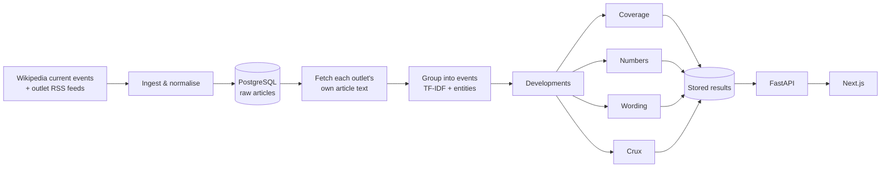

<div align="center">

# ONE I

### The news shapes what you believe. Who's checking the news?

[](https://github.com/Garv-Arora2/one-i/actions/workflows/ci.yml)


</div>

Meet **ONE I**, a media accountability engine built to question the stories we're told.

It reads the same story across a dozen newsrooms at once and catches what no single
article will ever show you: the death toll that changes depending on who you read, the
one word that quietly turns a victim into a suspect, the fact that only two outlets
bothered to mention. Then it lays it all out on one page, with the receipts, and hands
you the magnifying glass.

No bias scores. No AI verdicts. No one telling you what to think.
**Just the evidence, side by side. You decide.**

## Why this exists

One outlet says a country **attacked**. Another says it **retaliated**.

Same missiles. Same night. Same dead. The two words look like synonyms, but they aren't.
One gives you an aggressor. The other gives you someone hitting back. Read only one of
them and you walk away with an opinion you never chose to have.

That's where bias starts to form. Not with outright lies, but with a verb, with a number
rounded one way instead of the other, with the paragraph one newsroom kept and another
cut for space.

Now think about the last headline you reposted. The story you shared with a strong
caption. The take you were *sure* about. Which version of the story was it built on?

ONE I exists so you never have to guess.

## Follow one story through ONE I

### 1. Start with the stories worth questioning

ONE I only publishes a story once several outlets have covered it in enough detail to
compare. No feed, no categories, no algorithm deciding what you should care about.
Just the biggest stories, ready to be taken apart.


### 2. Get the crux in thirty seconds

What happened, who's involved, and the numbers being thrown around. Every point carries
a small badge like **5/11**: five of the eleven outlets reported it. In one glance you can
tell what's solid and what's resting on a single newsroom's word.


### 3. Watch it unfold

Every development in the order it was reported. The yellow ones are the details that most
outlets never ran. Those are the parts of the story most readers never see.


### 4. See who told you, and who didn't

Every outlet against every development, in one grid. A tick means they reported it, a
cross means they didn't, and a question mark means the evidence is too thin to say
either way. Click any mark to read exactly what that outlet wrote.

A missing fact is labelled *not reported*, never *hidden*. A gap can just as easily mean
a deadline or a word limit, and ONE I won't pretend to know which.


### 5. Catch the numbers that don't match

A building collapses in Gaza. One outlet reports **20 dead**, another **21**. One reports
**15 injured**, another **45**. That's three times as many.

ONE I only puts two figures side by side when they really measure the same thing: same
people, same unit, same period. A single strike is never compared with a war's total,
and soldiers are never compared with civilians. Click a dot to read the sentence each
figure came from.


### 6. Find the word that changed

**Attacked or defended?** The same act can be written either way, and the word an
outlet picks decides who you see as the aggressor before you've finished the sentence.

Take Ukraine's drone strikes on the warehouses of Wildberries, Russia's biggest online
retailer, in the summer of 2026:

> [Reuters](https://reuters.com/world/europe/ukrainian-drone-attacks-kill-seven-warehouse-workers-russia-spark-fire-moscow-2026-07-18): "Ukrainian drone **attacks** killed seven workers and injure 49 others at Wildberries warehouses"
>
> [BBC News](https://bbc.co.uk/news/articles/ce973yvk7pko): "Ukraine has escalated its **retaliatory** strikes in recent months, including attacks on several retail warehouses belonging to Russia's biggest online retailer, Wildberries."

Ukraine attacked. Ukraine retaliated. Same strikes, two different stories. Then in August,
when Russian missiles hit Kyiv, [Al Jazeera](https://aljazeera.com/news/2026/8/6/russian-strikes-kill-six-in-ukraine-as-moscow-intercepts-hundreds-of-drones)
described that attack as *"seen as **retaliation** for Ukraine's strikes on e-commerce giant
Wildberries."* Now Russia is the one hitting back. Depending on what you read, either side
can be the one who started it.

ONE I puts sentences like these next to each other, highlights the words that differ,
and says what kind of difference it is: action, responsibility, severity or certainty.
It never says which one is right. Here it is in the app, on the Gaza collapse: The New
York Times says the building was *"previously damaged by an Israeli **strike**"*, while BBC
News says a *"war-damaged Gaza building **collapses**"*. One names a cause. The other
leaves it to "war".


### 7. Hear what people are saying

The most-liked YouTube comments that are actually about the story. Shown for what they
are: public discussion, not proof of anything.


## How it works



Raw articles, processed text and analysis results live in separate tables, so every
result can be traced back to the article, URL and timestamp it came from.

| Step | Technique |
| --- | --- |
| **Event grouping** | TF-IDF cosine similarity plus shared named entities, within a time window, merged with union-find |
| **Developments** | Sentence-level clustering of what each outlet reported, so coverage is judged per fact rather than per article |
| **Coverage** | Similarity and keyword/entity overlap against each outlet's text; borderline matches become *coverage unclear* |
| **Numbers** | Rule-based extraction of counts, money and percentages (including spelled-out numbers), keyed by subject, unit, victim group and time period; only figures of the same magnitude are compared |
| **Wording** | Aligned passages about the same development, compared with small lexicons for action, responsibility, severity and certainty |
| **Public response** | English comments with no links that share a meaningful word with the event, ranked by likes |

Everything is deterministic and explainable: classical NLP with scikit-learn, NumPy
and Pandas. **No LLMs, no sentiment scores, no ideology classifiers.**

## Measured, not assumed

Every threshold is checked against a hand-labelled evaluation set that runs in CI:

| Task | Labelled items | Precision | Recall |
| --- | ---: | ---: | ---: |
| Event grouping (pairwise) | 105 | 1.000 | 1.000 |
| Coverage | 27 | 1.000 | 1.000 |
| Coverage timing | 27 | 1.000 | 1.000 |
| Number equivalence | 14 | 1.000 | 1.000 |
| Wording difference | 8 | 1.000 | 1.000 |

The set is small and was written alongside the rules, so these figures show the rules
do what they claim on known cases, not that they generalise perfectly.

## Principles

- **Observable evidence over interpretation.** Every claim on screen is backed by a sentence an outlet published.
- **"Coverage unclear" beats a forced answer.** If the match is weak, the interface says so.
- **"Not reported", never "omitted".** Absence is not intent.
- **Nothing is invented.** A missing API key means that source is shown as unavailable, not filled with placeholder data.
- **Public reaction is context, not authority.**

The full set of rules is in [`docs/principles.md`](docs/principles.md).

## Stack

| Layer | Technology |
| --- | --- |
| Frontend | Next.js 16, React 19, TypeScript, CSS Modules |
| Backend | FastAPI, SQLAlchemy 2, Alembic, Pydantic |
| Database | PostgreSQL (SQLite fallback for quick local runs) |
| Analysis | scikit-learn, NumPy, Pandas |
| Sign-in | Google Identity Services with a signed HttpOnly session cookie, plus Turnstile or reCAPTCHA |
| CI | GitHub Actions: tests, evaluation, lint and production build |

## Run it locally

**Requirements:** Python 3.12+, Node 20+, Docker.

```bash
# 1. Database
docker compose up -d

# 2. Backend
cd backend
python -m venv .venv
source .venv/bin/activate          # Windows: .venv\Scripts\activate
pip install -r requirements.txt
cp .env.example .env               # fill in only the keys you have
python -m app.cli migrate
python -m app.cli seed-demo        # optional: a small fictional dataset
uvicorn app.main:app --port 8000

# 3. Frontend (second terminal)
cd frontend
npm install
cp .env.example .env.local
npm run dev                        # http://localhost:3000
```

Every external key is optional; run `python -m app.cli providers` to see which
sources are configured. Keys live only in the git-ignored `.env` files.

### Keeping the news current

```bash
python -m app.cli update   # fetch news, fetch outlet text, re-analyse, collect comments
```

`scripts/daily_update.ps1` runs this on a schedule (it includes the one-line command to
register it with Windows Task Scheduler).

| Command | Purpose |
| --- | --- |
| `ingest --history-days 180` | Backfill months of world news from Wikipedia's daily current-events pages |
| `enrich` | Fetch the outlets' own article text where only a summary is stored |
| `analyze` | Rebuild every stored analysis result |
| `reactions [--refresh]` | Collect YouTube comments for published events |
| `providers` | Show which external services are configured |
| `copy-db --source URL --target URL` | Copy all data between databases (e.g. SQLite to PostgreSQL) |

## Tests

```bash
cd backend
python -m pytest                     # 232 tests: grouping, coverage, numbers, wording, reactions, API, auth
python -m evaluation.run_evaluation  # precision and recall against the labelled set

cd frontend
npm run lint
npm run build                        # type-check and production build
```

## Repository layout

```
backend/
  app/
    api/          HTTP routes: events, sources, auth, health
    ingestion/    news providers, normalising, de-duplicating, fetching outlet text
    analysis/     grouping, developments, coverage, numbers, wording, crux, reaction
    services/     runs the analysis and builds API responses
    models/       database tables
    schemas/      API response shapes
    core/         settings, security, time helpers
    cli.py        operational commands
  alembic/        migrations
  evaluation/     hand-labelled accuracy set
  tests/
frontend/
  app/            landing, front page, event page, outlet pages, sign-in
  components/     event sections: timeline, coverage, numbers, wording, reaction
  lib/            API client and shared types
docs/
  specs/          how each analysis feature is defined
  screenshots/
scripts/          scheduled daily update
```

## Documentation

- [Principles](docs/principles.md): the rules the product is built on, and what V1 deliberately leaves out
- [Product](docs/product.md) and [design](docs/design.md)
- [Architecture](docs/architecture.md), [database](docs/database.md) and [API](docs/api.md)
- Feature specs: [crux](docs/specs/crux.md), [coverage](docs/specs/coverage.md), [numbers and framing](docs/specs/framing-and-numbers.md), [public reaction](docs/specs/public-reaction.md)

## Roadmap

- **Market impact (V2).** Price return against a benchmark for events that involve listed companies. The data and calculation layer already exists; it stays hidden until it can be shown without implying causation from timing alone.

## License

[MIT](LICENSE)
