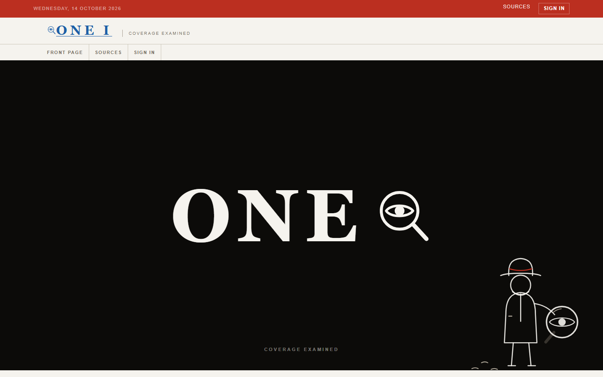
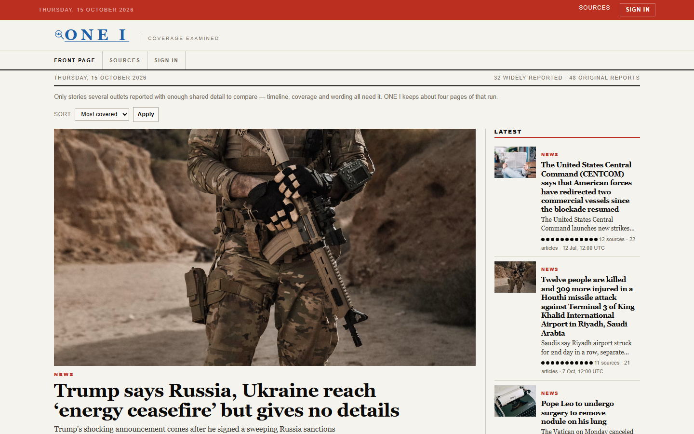
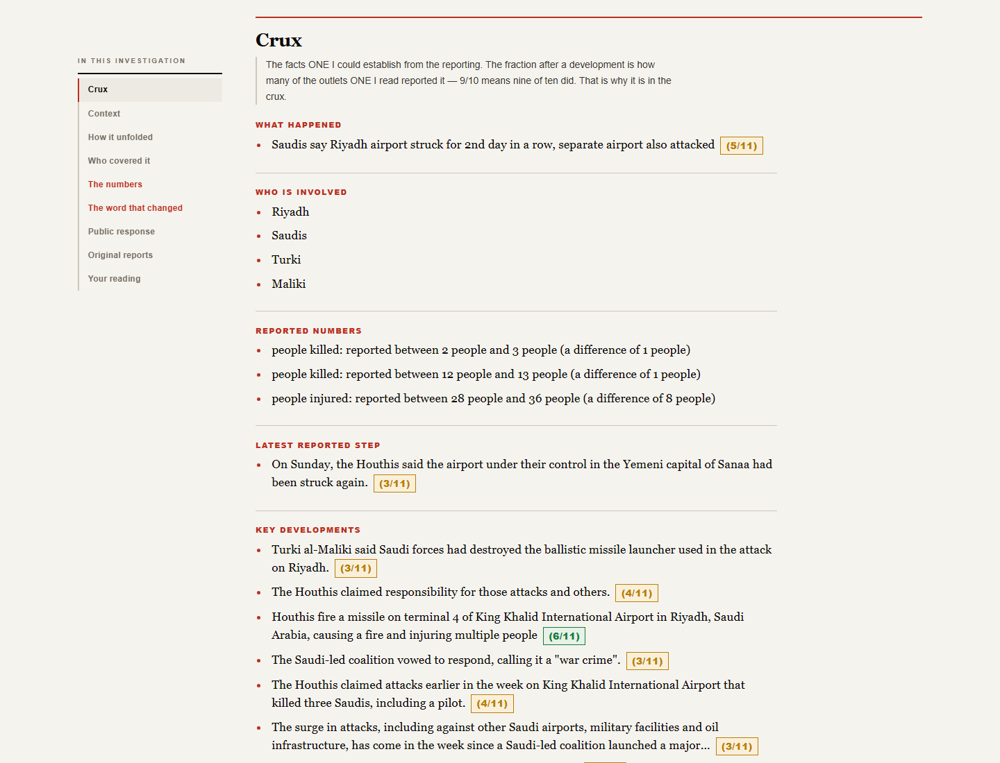
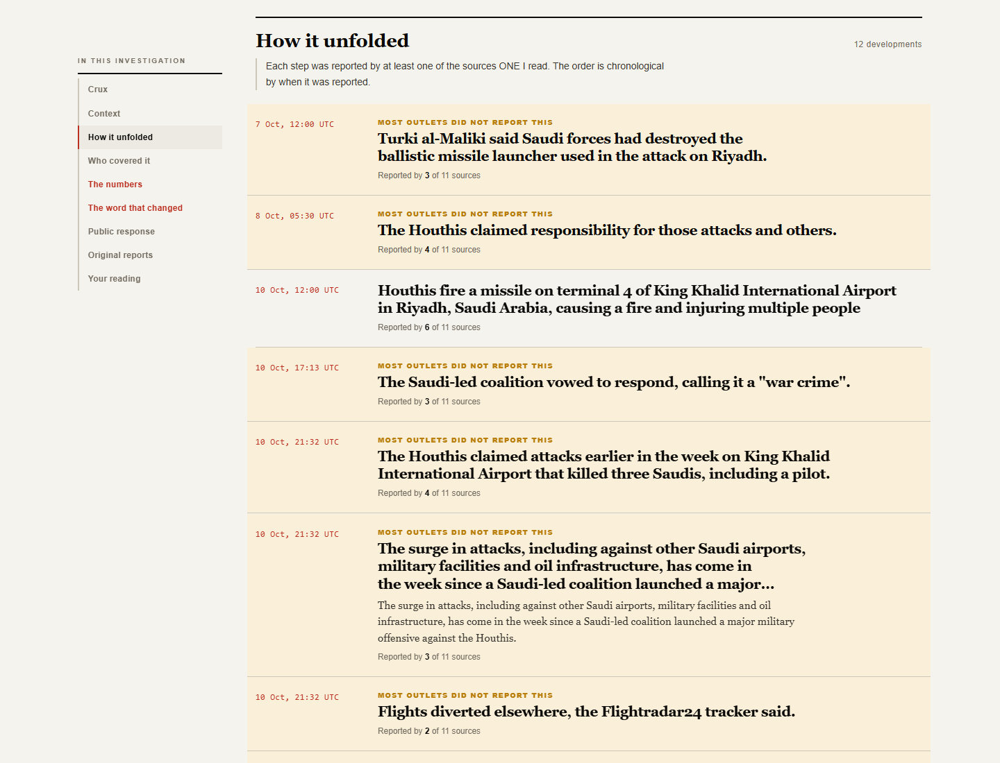
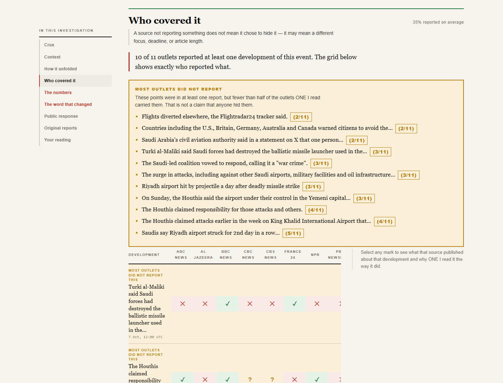
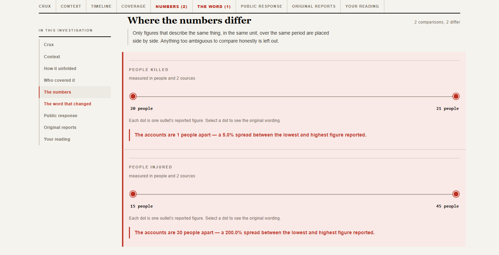
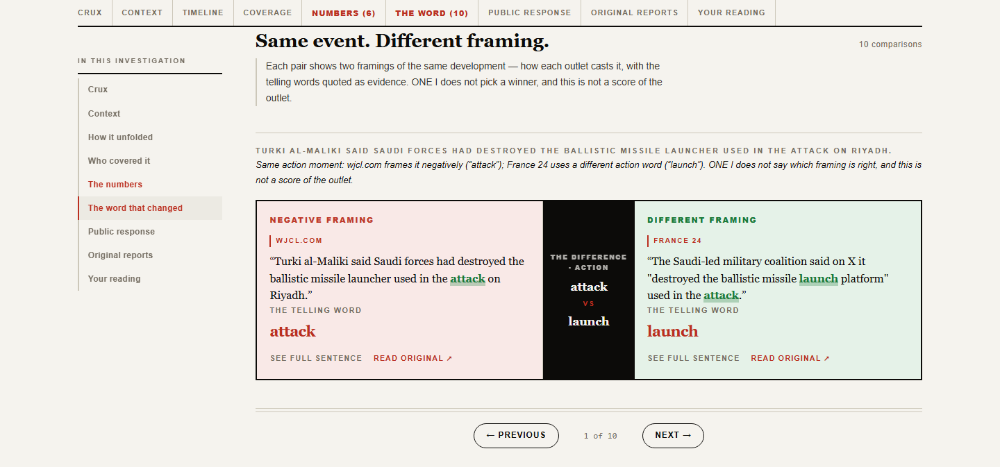
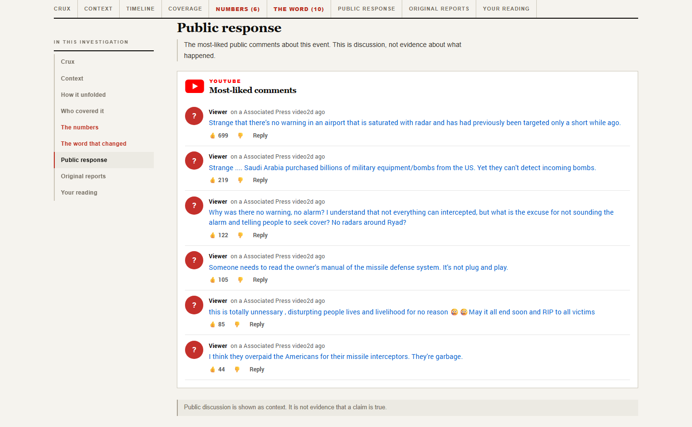
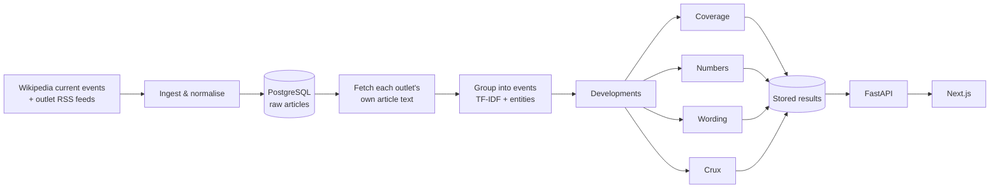

<div align="center">

# ONE I

### Show the difference. Let the reader decide.

An investigative news reader that lines up how many outlets covered the same world event —
what they agree on, which figures they disagree about, and which words they chose —
without ever telling you who is "biased".

[](https://github.com/Garv-Arora2/one-i/actions/workflows/ci.yml)




</div>

---

## Why this exists

When a missile hits an airport, one outlet reports 12 dead, another 13. One says the
militia *attacked*, another that it *launched*. One outlet carries the government's
statement, four don't mention it. Each article on its own reads as the whole story.

ONE I reads them together. It groups articles about the same event, works out the
individual developments, and shows — with each outlet's own sentences as evidence —
exactly where the coverage lines up and where it doesn't.

It deliberately stops there. There are no bias scores, no "trust ratings", no claims
about intent. **The observable differences are the product; the judgement stays with the reader.**

## A tour of one event

### The front page

Only events that several outlets reported with enough shared detail are published.
One lead story, smaller stories alongside — no categories, no feed, no personalisation.



### The crux

What happened, who is involved, and the figures being reported. The fraction beside
each development is how many of the outlets carried it, so you can see at a glance
what is established and what rests on one or two reports.



### How it unfolded

Every development in the order it was reported, with how many sources reported it.
Points that most outlets did not carry are flagged.



### Who covered it

A grid of every outlet against every development: reported, not reported, or
*coverage unclear* when the evidence isn't strong enough to say. Click any mark to
read the sentence that decided it. A gap is described as "not reported" — never as
"omitted" — because a missing paragraph can just as easily mean a deadline or a word limit.



### Where the numbers differ

Figures are only placed side by side when they measure the same thing, in the same
unit, over the same period. A single strike's toll is never compared with a war's
running total; soldiers are never compared with civilians. Each dot is one outlet,
and clicking it shows the original wording.



### The word that changed

The same development, as two outlets wrote it, with the telling word highlighted —
*attack* versus *launch*, *killed* versus *died*. ONE I names the kind of difference
(action, responsibility, severity, certainty) and does not pick a winner.



### Public response

The most-liked YouTube comments that are actually about the event. This is shown as
public discussion, explicitly not as evidence.



## How it works



Raw articles, processed text and analysis results live in separate tables, so every
result can be traced back to the article, URL and timestamp it came from.

| Step | Technique |
| --- | --- |
| **Event grouping** | TF-IDF cosine similarity plus shared named entities, within a time window, merged with union-find |
| **Developments** | Sentence-level clustering of what each outlet reported, so coverage is judged per fact rather than per article |
| **Coverage** | Similarity and keyword/entity overlap against each outlet's text; borderline matches become *coverage unclear* |
| **Numbers** | Rule-based extraction of counts, money and percentages (including spelled-out numbers), keyed by subject, unit, victim group and time period; only figures of the same magnitude are compared |
| **Wording** | Aligned passages about the same development, compared with small lexicons for action, responsibility, severity and certainty |
| **Public response** | English comments with no links that share a meaningful word with the event, ranked by likes |

Everything is deterministic and explainable: classical NLP with scikit-learn, NumPy
and Pandas. **No LLMs, no sentiment scores, no ideology classifiers.**

## Measured, not assumed

Every threshold is checked against a hand-labelled evaluation set that runs in CI:

| Task | Labelled items | Precision | Recall |
| --- | ---: | ---: | ---: |
| Event grouping (pairwise) | 105 | 1.000 | 1.000 |
| Coverage | 27 | 1.000 | 1.000 |
| Coverage timing | 27 | 1.000 | 1.000 |
| Number equivalence | 14 | 1.000 | 1.000 |
| Wording difference | 8 | 1.000 | 1.000 |

The set is small and was written alongside the rules, so these figures show the rules
do what they claim on known cases, not that they generalise perfectly.

## Principles

- **Observable evidence over interpretation.** Every claim on screen is backed by a sentence an outlet published.
- **"Coverage unclear" beats a forced answer.** If the match is weak, the interface says so.
- **"Not reported", never "omitted".** Absence is not intent.
- **Nothing is invented.** A missing API key means that source is shown as unavailable, not filled with placeholder data.
- **Public reaction is context, not authority.**

The full set of rules is in [`docs/principles.md`](docs/principles.md).

## Stack

| Layer | Technology |
| --- | --- |
| Frontend | Next.js 16, React 19, TypeScript, CSS Modules |
| Backend | FastAPI, SQLAlchemy 2, Alembic, Pydantic |
| Database | PostgreSQL (SQLite fallback for quick local runs) |
| Analysis | scikit-learn, NumPy, Pandas |
| Sign-in | Google Identity Services with a signed HttpOnly session cookie, plus Turnstile or reCAPTCHA |
| CI | GitHub Actions: tests, evaluation, lint and production build |

## Run it locally

**Requirements:** Python 3.12+, Node 20+, Docker.

```bash
# 1. Database
docker compose up -d

# 2. Backend
cd backend
python -m venv .venv
source .venv/bin/activate          # Windows: .venv\Scripts\activate
pip install -r requirements.txt
cp .env.example .env               # fill in only the keys you have
python -m app.cli migrate
python -m app.cli seed-demo        # optional: a small fictional dataset
uvicorn app.main:app --port 8000

# 3. Frontend (second terminal)
cd frontend
npm install
cp .env.example .env.local
npm run dev                        # http://localhost:3000
```

Every external key is optional; run `python -m app.cli providers` to see which
sources are configured. Keys live only in the git-ignored `.env` files.

### Keeping the news current

```bash
python -m app.cli update   # fetch news, fetch outlet text, re-analyse, collect comments
```

`scripts/daily_update.ps1` runs this on a schedule (it includes the one-line command to
register it with Windows Task Scheduler).

| Command | Purpose |
| --- | --- |
| `ingest --history-days 180` | Backfill months of world news from Wikipedia's daily current-events pages |
| `enrich` | Fetch the outlets' own article text where only a summary is stored |
| `analyze` | Rebuild every stored analysis result |
| `reactions [--refresh]` | Collect YouTube comments for published events |
| `providers` | Show which external services are configured |
| `copy-db --source URL --target URL` | Copy all data between databases (e.g. SQLite to PostgreSQL) |

## Tests

```bash
cd backend
python -m pytest                     # 232 tests: grouping, coverage, numbers, wording, reactions, API, auth
python -m evaluation.run_evaluation  # precision and recall against the labelled set

cd frontend
npm run lint
npm run build                        # type-check and production build
```

## Repository layout

```
backend/
  app/
    api/          HTTP routes: events, sources, auth, health
    ingestion/    news providers, normalising, de-duplicating, fetching outlet text
    analysis/     grouping, developments, coverage, numbers, wording, crux, reaction
    services/     runs the analysis and builds API responses
    models/       database tables
    schemas/      API response shapes
    core/         settings, security, time helpers
    cli.py        operational commands
  alembic/        migrations
  evaluation/     hand-labelled accuracy set
  tests/
frontend/
  app/            landing, front page, event page, outlet pages, sign-in
  components/     event sections: timeline, coverage, numbers, wording, reaction
  lib/            API client and shared types
docs/
  specs/          how each analysis feature is defined
  screenshots/
scripts/          scheduled daily update
```

## Documentation

- [Principles](docs/principles.md) — the rules the product is built on, and what V1 deliberately leaves out
- [Product](docs/product.md) and [design](docs/design.md)
- [Architecture](docs/architecture.md), [database](docs/database.md) and [API](docs/api.md)
- Feature specs: [crux](docs/specs/crux.md), [coverage](docs/specs/coverage.md), [numbers and framing](docs/specs/framing-and-numbers.md), [public reaction](docs/specs/public-reaction.md)

## Roadmap

- **Market impact (V2).** Price return against a benchmark for events that involve listed companies. The data and calculation layer already exists; it stays hidden until it can be shown without implying causation from timing alone.

## License

[MIT](LICENSE)
